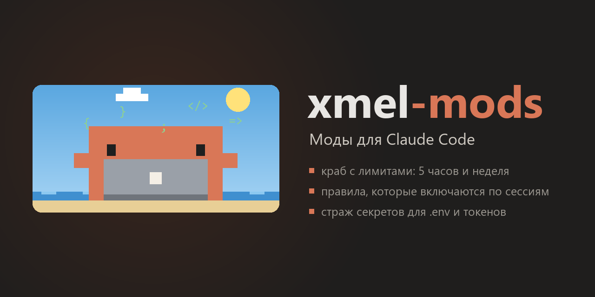

**English** · [Русский](README.ru.md)

<p align="center">
  
</p>

<p align="center">
  Three mods for <a href="https://code.claude.com/docs/en/plugins/mods/overview">Claude Code</a>:
  a crab that shows your usage limits, per-session rule sets, and a secret guard.
</p>

> The screenshots show the interface in Russian; the mods' UI text is currently Russian only.

---

## What's inside

| Mod | What it does |
|---|---|
| 🦀 [**usage-crab**](usage-crab/) | Shows your 5-hour and weekly limits, time until reset, and what the usage went on. A pixel crab lives in the panel: it codes while Claude answers, drinks coffee, dances, sweats when the limit runs out, and its background follows the time of day. |
| 📏 [**session-rules**](session-rules/) | Rule sets (for example, how to write commits) live in separate files and are switched on per session with one button. Can auto-enable for a specific project folder. |
| 🛡️ [**secret-guard**](secret-guard/) | Hides tokens, keys and passwords from the model: in command output, in files it reads, and in your messages. Stops you from committing `.env` and keys. Has pause buttons and a panel with recent events. |

The mods are independent: install all three or only the ones you need.

## Installation

You need **Claude Code 2.1.287 or newer**, the version that introduced mods. Check with `claude --version`, update with `claude update`.

### In the terminal (Claude Code CLI)

Type one line per mod inside Claude Code:

```
/plugin install usage-crab --marketplace igorxmel/xmel-mods
/plugin install session-rules --marketplace igorxmel/xmel-mods
/plugin install secret-guard --marketplace igorxmel/xmel-mods
```

Answer `y` to the first "Add marketplace?" question, then press Enter to install the mod for your user. It works right away.

The same from a regular shell:

```bash
claude plugin install usage-crab --marketplace igorxmel/xmel-mods
```

### In the Claude app (Code tab)

Click **+** next to the input field → **Plugins** → **Add marketplace** and enter `igorxmel/xmel-mods`. Then **Add plugin** and pick the mods you want.

### Updating and removing

```bash
claude plugin update usage-crab@xmel-mods
claude plugin uninstall usage-crab@xmel-mods
```

After an update, run `/reload-plugins` in sessions that are already open.

## Security

Mods have the same access to your computer as Claude Code itself. Read a mod's code before installing someone else's. The code of these mods is here in full, in the `hooks/` folders. Each mod's README spells out what it does.

- **usage-crab** asks Anthropic for your limits every 5 minutes through your session's own sign-in: Claude Code supplies the token, the mod never sees it. Besides that, it writes data to `~/.claude/usage-crab/`.
- **session-rules** reads and writes only `~/.claude/session-rules/`.
- **secret-guard** makes no network calls. It keeps found secret values in memory only and never writes them to disk.

## License

[MIT](LICENSE). Use it, change it, share it.
