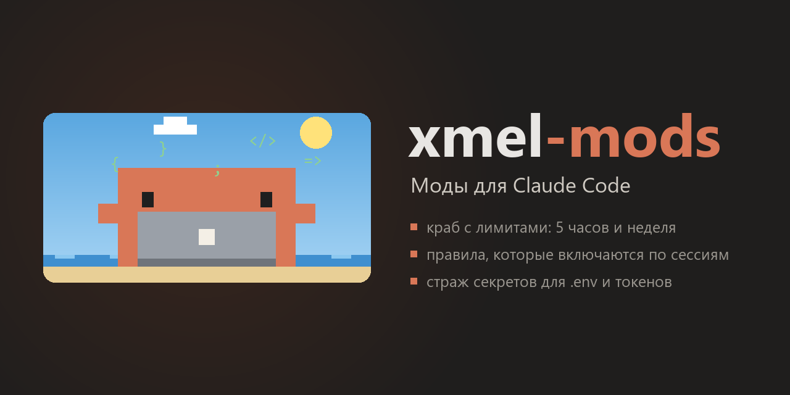

**[English](README.md)** · Русский

<p align="center">
  
</p>

<p align="center">
  Три мода для <a href="https://code.claude.com/docs/en/plugins/mods/overview">Claude Code</a>:
  краб с лимитами, правила по сессиям и страж секретов.
  Интерфейс на английском и русском.
</p>

---

## Что внутри

| Мод | Что делает |
|---|---|
| 🦀 [**usage-crab**](usage-crab/) | Показывает лимит за 5 часов и за неделю, время до сброса и на что ушёл расход. В панели живёт пиксельный краб: он кодит, пока Claude отвечает, пьёт кофе, танцует, потеет, когда лимит кончается, а фон за ним меняется по времени суток. |
| 📏 [**session-rules**](session-rules/) | Наборы правил (например, как писать коммиты) хранятся в отдельных файлах и включаются кнопкой в нужной сессии. Можно настроить автовключение для конкретной папки проекта. |
| 🛡️ [**secret-guard**](secret-guard/) | Прячет токены, ключи и пароли от модели: в выводе команд, в прочитанных файлах и в твоих сообщениях. Не даёт закоммитить `.env` и ключи. Есть кнопки паузы и панель с последними событиями. |

Моды независимы друг от друга: ставь все три или только нужные.

## Язык

По умолчанию интерфейс английский. Переключить на русский (и обратно) можно кнопкой **🌐 EN · RU** в панели любого мода или командами `/crab lang`, `/rules lang`, `/secrets lang`. Чтобы выбрать язык сразу, добавь `en` или `ru`, например `/crab lang ru`.

Выбор общий: он хранится в одном файле `~/.claude/xmel-mods-lang.txt`, поэтому все три мода подхватывают его за несколько секунд, во всех открытых сессиях. У secret-guard язык ещё определяет, как выглядят метки вместо секретов, которые видит модель (`[hidden: …]` или `[скрыто: …]`).

## Установка

Нужен **Claude Code 2.1.287 или новее**: моды появились в этой версии. Проверить версию можно командой `claude --version`, обновить — `claude update`.

### В терминале (Claude Code CLI)

Набери в Claude Code по строке на каждый мод:

```
/plugin install usage-crab --marketplace igorxmel/xmel-mods
/plugin install session-rules --marketplace igorxmel/xmel-mods
/plugin install secret-guard --marketplace igorxmel/xmel-mods
```

На первый вопрос «Add marketplace?» ответь `y`, затем нажми Enter, чтобы поставить мод для своего пользователя. Мод заработает сразу.

То же самое из обычной командной строки:

```bash
claude plugin install usage-crab --marketplace igorxmel/xmel-mods
```

### В приложении Claude (вкладка Code)

Нажми **+** рядом с полем ввода → **Plugins** → **Add marketplace** и введи `igorxmel/xmel-mods`. Затем **Add plugin** и выбери нужные моды.

### Обновление и удаление

```bash
claude plugin update usage-crab@xmel-mods
claude plugin uninstall usage-crab@xmel-mods
```

После обновления в уже открытых сессиях набери `/reload-plugins`.

## Безопасность

У модов тот же доступ к компьютеру, что и у самого Claude Code. Прежде чем ставить чужие моды, загляни в их код. Код этих модов лежит здесь целиком, в папках `hooks/`. Что именно делает каждый мод, расписано в его README.

- **usage-crab** раз в 5 минут спрашивает лимиты у Anthropic через вход твоей сессии: токен подставляет Claude Code, мод его не видит. Кроме этого, мод пишет данные в `~/.claude/usage-crab/`.
- **session-rules** читает и пишет только `~/.claude/session-rules/`.
- **secret-guard** никуда не ходит по сети. Найденные значения секретов он держит только в памяти и на диск не пишет.

## Лицензия

[MIT](LICENSE). Пользуйся, меняй, делись.
