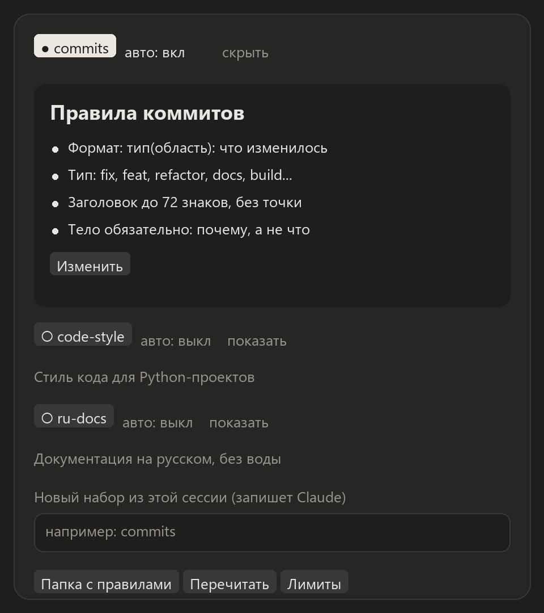

# 📏 session-rules

Правила, к которым ты пришёл с Claude в одном проекте (как писать коммиты, стиль кода, язык документации), можно сохранить и включать в любой другой сессии одной кнопкой.

<p align="center"></p>

## Установка

```
/plugin install session-rules --marketplace igorxmel/xmel-mods
```

Другие способы описаны в [общем README](../README.md#установка).

## Как пользоваться

1. **Сохрани правила.** В сессии, где правила уже выработаны, открой панель (`/rules`) и впиши название в поле «Новый набор из этой сессии», например `commits`. Claude сам соберёт правила из разговора и запишет их в файл. Можно и вручную: поле «Новый набор вручную» создаёт пустой файл и сразу открывает его на правку.
2. **Включи в другой сессии.** Нажми на набор (○ → ●). Правила добавятся в системный промпт Claude и будут действовать до конца сессии. В строке статуса видно, какие наборы включены.
3. **Автовключение.** «авто» рядом с набором включает его само каждый раз, когда сессия открыта в этой папке проекта.

Каждый набор можно раскрыть (`показать`), прочитать и отредактировать прямо в панели: **Enter** сохраняет, **Shift+Enter** переносит строку.

## Где лежат правила

Обычные Markdown-файлы в `~/.claude/session-rules/`, по одному на набор:

```markdown
# Правила коммитов

- Формат: `тип(область): что изменилось`
- Заголовок до 72 знаков, без точки
- Тело обязательно: почему, а не что
```

Первая строка `# …` становится названием набора. Новые и изменённые файлы мод подхватывает сам за несколько секунд. Кнопка «📂 Папка с правилами» открывает эту папку в проводнике.

## Команды

| Команда | Что делает |
|---|---|
| `/rules` | открыть панель |
| `/rules list` | список наборов, ● — включённые |
| `/rules on <имя>` / `off <имя>` | включить или выключить набор в этой сессии |
| `/rules auto <имя>` | включать набор автоматически в этой папке |
| `/rules save <имя>` | попросить Claude записать правила из этой сессии |
| `/rules reload` | перечитать папку |
