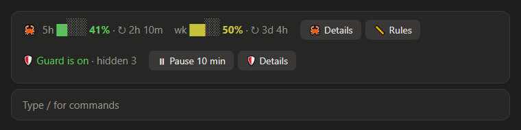
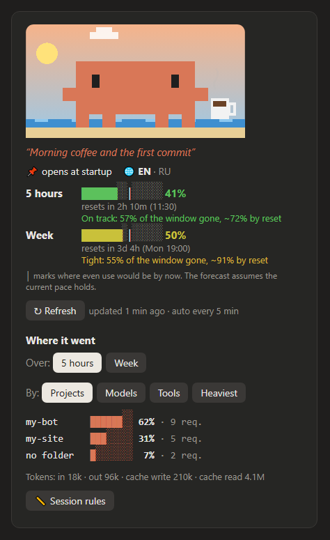
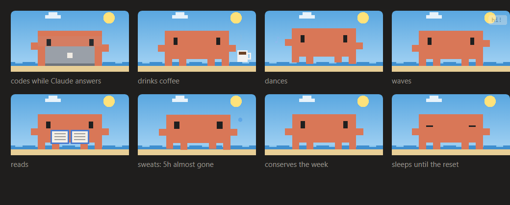
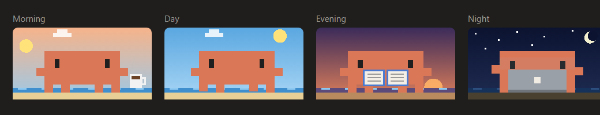

# 🦀 usage-crab

**English** · [Русский](README.ru.md)

Your Claude limits for 5 hours and for the week, always in view. Shows time until reset and what the usage went on. A pixel crab lives in the panel, and its mood depends on your limits.

<p align="center"></p>

> The interface is English by default; the 🌐 EN · RU button in the panel (or `/crab lang`) switches it to Russian. The Russian screenshots are in the [Russian README](README.ru.md).

## Installation

```
/plugin install usage-crab --marketplace igorxmel/xmel-mods
```

Other ways are described in the [main README](../README.md#installation). Limits exist only on a subscription (Pro, Max, Team, Enterprise). When signed in with an API key the mod shows "no data".

## Features

**Row above the input.** Percentages for 5 hours and for the week, plus time until reset. The "🦀 Details" button opens the panel; "📏 Rules" opens the panel of the [session-rules](../session-rules/) mod, if installed. Below it, in the same area, sits the row of the [secret-guard](../secret-guard/) mod: it adds that row itself when installed.

<p align="center"></p>

**Panel** (the Details button or the `/crab` command):
- limit bars that smoothly shift from green to red, and the exact reset time;
- a **pace forecast** under each bar: will the limit last until the reset (see below);
- **"Where it went"**: a breakdown over 5 hours or the week by project, model and tool, plus a list of the heaviest requests with their text;
- a "↻ Refresh" button and a 📌 that decides whether the panel opens at startup.

### Pace forecast

Under each limit the panel tells whether you are likely to make it to the reset. It compares how much of the window has passed with how much you have used:

- the `│` mark on the bar is where *even* use would be right now (for the week: the share of the 7 days gone);
- if you keep spending at the same rate, the usage at reset would be `used ÷ share of time gone`;
- the verdict is colored: **on track** (under 85% by reset), **tight** (85–100%) or **runs out** (over 100%, with how long before the reset it happens and around what time).

Example: 3 hours into a 5-hour window with 53% used gives `Tight: 60% of the window gone, ~88% by reset`. Right at the start of a window (first 3%) it says it is too early to tell. When the limit is already used up there is nothing to forecast. The forecast assumes even use, so a week with quiet nights and weekends will usually end lower than predicted.

### The crab

The crab's mood depends on both limits: the 5-hour one decides how hectic it is right now, the weekly one decides whether it is conserving at all.

<p align="center"></p>

| Condition | Crab |
|---|---|
| Claude is answering | codes on a laptop, `{ } ; </>` fly above it |
| all calm | strolls, drinks coffee, dances, waves, reads: the activity changes every minute |
| 5 hours ≥ 80% | sweats and bustles |
| week ≥ 80%, 5 hours fine | conserves the week: walks slowly, advises postponing heavy work |
| limit exhausted | sleeps until the reset |

The background behind it follows your computer's clock, and the phrases match the time of day:

<p align="center"></p>

In the terminal the crab is drawn with characters and does not animate.

## How it works

- **Limits** arrive two ways: with every model response and by polling every 5 minutes. Polling uses the same endpoint as `/usage`, and Claude Code supplies the token. If the server answers "too many requests" (429), all sessions wait as long as it asks.
- **Several windows.** Sessions share the numbers through `~/.claude/usage-crab/limits.json`, so every window shows the same percentages. Only one session polls the server.
- **"Where it went"** is computed from token cost: an expensive model and a long context use up the limit faster. No money is charged; it is just a weight. Only sessions where the mod was enabled are counted. The log is kept in `~/.claude/usage-crab/log-*.json` for 8 days.

If polling gets in the way, the `CLAUDE_CODE_DISABLE_NONESSENTIAL_TRAFFIC=1` variable turns it off. The numbers then update only after model responses.

## Commands

| Command | What it does |
|---|---|
| `/crab` | open the panel |
| `/crab lang [en\|ru]` | switch the interface language (without an argument it toggles) |
