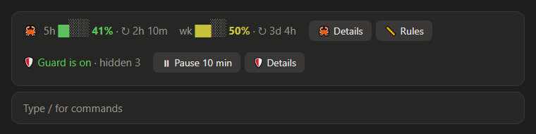
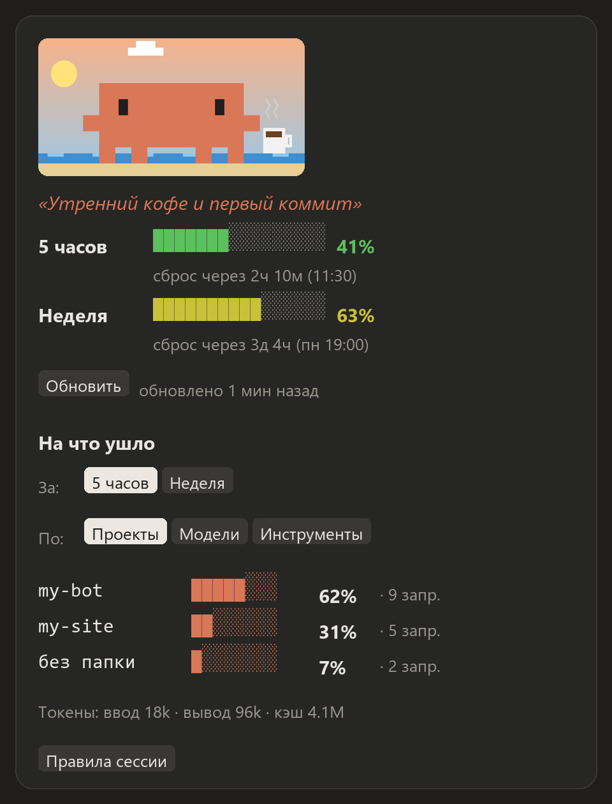
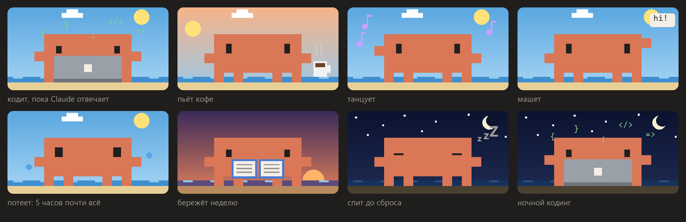
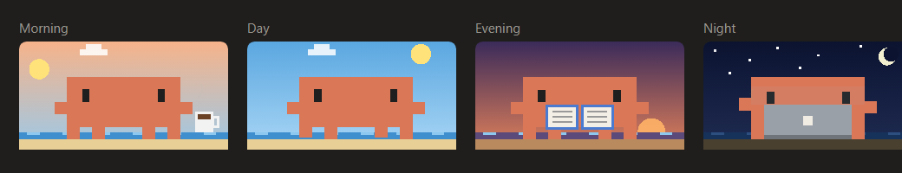

# 🦀 usage-crab
**[English](README.md)** · Русский

Лимиты Claude за 5 часов и за неделю всегда перед глазами. Показывает время до сброса и на что ушёл расход. В панели живёт пиксельный краб, чьё настроение зависит от лимитов.

<p align="center"></p>

## Установка

```
/plugin install usage-crab --marketplace igorxmel/xmel-mods
```

Другие способы описаны в [общем README](../README.ru.md#установка). Лимиты есть только на подписке (Pro, Max, Team, Enterprise). При входе по API-ключу мод покажет «нет данных».

## Что умеет

**Строка над полем ввода.** Проценты за 5 часов и за неделю и время до сброса. Кнопка «🦀 Подробнее» открывает панель, «📏 Правила» — панель мода [session-rules](../session-rules/), если он установлен. Ниже в этой же области стоит строка мода [secret-guard](../secret-guard/): он добавляет её сам, если установлен.

<p align="center"></p>

**Панель** (кнопка «Подробнее» или команда `/crab`):
- полоски лимитов, которые плавно краснеют от зелёного к красному, и точное время сброса;
- **«На что ушло»**: разбивка за 5 часов или неделю по проектам, моделям, инструментам и список самых тяжёлых запросов с их текстом;
- кнопка «↻ Обновить» и 📌, которая решает, открывать ли панель при запуске.

### Краб

Настроение краба зависит от обоих лимитов: пятичасовой решает, насколько он суетится сейчас, недельный — бережётся ли он вообще.

<p align="center"></p>

| Условие | Краб |
|---|---|
| Claude отвечает | кодит на ноутбуке, над ним летят `{ } ; </>` |
| всё спокойно | гуляет, пьёт кофе, танцует, машет, читает: занятие меняется раз в минуту |
| 5 часов ≥ 80% | потеет и мельтешит |
| неделя ≥ 80%, а 5 часов в норме | бережёт неделю: ходит медленно, советует отложить тяжёлое |
| лимит кончился | спит до сброса |

Фон за ним меняется по часам твоего компьютера, а фразы подстраиваются под время суток:

<p align="center"></p>

В терминале краб рисуется символами и не анимируется.

## Как это работает

- **Лимиты** приходят двумя путями: вместе с каждым ответом модели и опросом раз в 5 минут. Опрос идёт через тот же вход, что и `/usage`, токен подставляет Claude Code. Если сервер отвечает «слишком часто» (429), все сессии ждут столько, сколько он просит.
- **Несколько окон.** Сессии делятся цифрами через `~/.claude/usage-crab/limits.json`, поэтому во всех окнах проценты одинаковые. Опрашивает сервер только одна сессия.
- **«На что ушло»** считается по стоимости токенов: дорогая модель и длинный контекст расходуют лимит быстрее. Деньги не списываются, это просто вес. Учитываются только сессии, где мод был включён. Журнал хранится в `~/.claude/usage-crab/log-*.json` 8 дней.

Если опрос мешает, его отключает переменная `CLAUDE_CODE_DISABLE_NONESSENTIAL_TRAFFIC=1`. Цифры тогда обновляются только после ответов модели.

## Команды

| Команда | Что делает |
|---|---|
| `/crab` | открыть панель |
